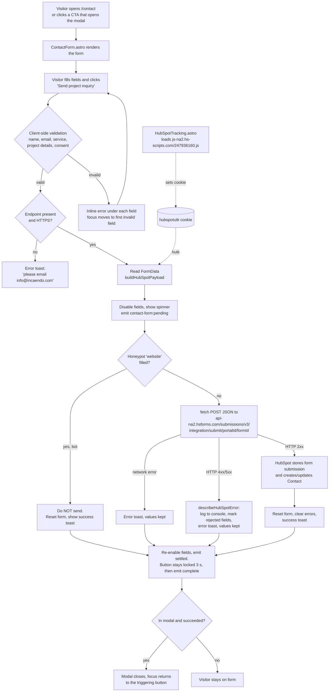

# Contact Us Form → HubSpot Integration

Technical documentation for how the Incaendo corporate website's project
inquiry form sends submissions to HubSpot.

| | |
| --- | --- |
| **Repository** | `incaendo-corp` (Astro 7 + Bootstrap 5, static build) |
| **Integration method** | Browser → HubSpot **Forms Submission API v3** (public, unauthenticated endpoint) |
| **HubSpot form** | "Incaendo Website Project Inquiry" (name taken from the code comment in `src/scripts/hubspot-form.js`) |
| **Backend / server code** | None. The site has no server-side handler for the form. |
| **Credentials** | None. No API key or private app token is used anywhere. |
| **Status in git** | The integration is in the working tree on `feature/website-enhancement` and is **not yet committed** (`src/scripts/hubspot-form.js` and `src/components/HubSpotTracking.astro` are untracked; `ContactForm.astro`, the layouts, `README.md` and `.env.example` are modified). |

> **Legend.** Statements in this document are verified against the code unless
> marked **Not verified in the codebase** or **Requires confirmation from
> HubSpot**. Values that live only in the HubSpot dashboard cannot be seen
> from the repository.

---

## 1. Overview

### What the integration does

Every page of the website includes a project inquiry form. It appears in two places:

1. **Inline on the Contact page** (`/contact`).
2. **In a pop-up modal** ("Let's Talk about Your Project"), which opens from
   the site's call-to-action buttons and links (11 `data-open-contact-modal`
   triggers across the source).

Both use the same form component. When a visitor submits it, the browser
validates the fields, converts them into the JSON format HubSpot expects and
sends them **directly to HubSpot's Forms API**. HubSpot records it as a
submission of the "Incaendo Website Project Inquiry" form and creates or
updates the matching **Contact** record (matched on email).

The site also loads the **HubSpot tracking code** on every page. It sets the
`hubspotutk` cookie, which is sent with each submission. HubSpot uses it to
link the inquiry to the visitor's browsing history on the site.

### Why HubSpot

- Inquiries go straight into the CRM, where sales can see, assign and follow
  them up. Nobody has to copy them out of an email inbox.
- HubSpot already provides form-submission storage, contact de-duplication,
  notifications and workflows, so the website needs no database, mail server
  or backend of its own.
- Combined with the tracking code, each lead shows which pages the visitor
  viewed before getting in touch (source attribution).

> The business reasons above describe what the implementation makes possible.
> The business decision to choose HubSpot is **not recorded in the codebase**.

### Implementation summary

| Concern | How it is handled |
| --- | --- |
| Form markup and validation | `src/components/ContactForm.astro` (custom HTML form, not a HubSpot embed) |
| HubSpot IDs, endpoint, field mapping, error parsing | `src/scripts/hubspot-form.js` |
| Visitor tracking cookie | `src/components/HubSpotTracking.astro`, included in both layouts |
| Success / error feedback | Toast notifications from `src/scripts/toast.js` |
| Modal behavior while sending | `src/scripts/contact-modal.js` listens to events emitted by the form |
| Spam | Hidden "honeypot" field (no CAPTCHA) |

---

## 2. Integration Architecture

The website is a **static site**: `npm run build` produces plain HTML, CSS and
JS in `dist/`. Nothing runs on a server at request time. So the
integration runs entirely in the visitor's browser and talks to HubSpot over
HTTPS.



### Intermediate steps explained

1. **Rendering (build time).** At build time, `ContactForm.astro` imports
   `HUBSPOT_SUBMIT_URL` and writes it into the form's `data-endpoint`
   attribute. The endpoint is therefore baked into the static HTML.
2. **Tracking script (page load).** `HubSpotTracking.astro` adds an `async`
   script tag for HubSpot's tracking code. HubSpot's script sets the
   `hubspotutk` cookie. This runs independently of the form.
3. **Validation (browser).** The form has `novalidate`, so the browser's own
   pop-up validation is switched off. Custom JavaScript shows consistent
   inline messages instead.
4. **Payload building (browser).** `buildHubSpotPayload()` maps each website
   field name to a HubSpot contact property and adds page context.
5. **Submission (browser → HubSpot).** It uses one `fetch` `POST` with a JSON
   body. HubSpot's public submission endpoint accepts cross-origin requests
   (CORS), per the code comment in `hubspot-form.js` lines 3–5.
6. **Response handling (browser).** A 2xx response means success. Any other
   status is parsed for HubSpot's `errors` array to decide which fields to
   highlight.

---

## 3. Technology and Components

| Component | Type | Responsibility |
| --- | --- | --- |
| `src/pages/contact.astro` | Astro page | Contact page. Renders `<ContactForm />` (line 168) inside `.contact-form-card`. |
| `src/components/ContactModal.astro` | Astro component | Modal dialog with `<ContactForm idPrefix="modal" />` (line 37). `idPrefix` keeps element IDs unique when both forms exist on `/contact`. |
| `src/components/ContactForm.astro` | Astro component + client `<script>` | Form markup, client validation, submit flow, loading state, honeypot, lifecycle events, toasts. |
| `src/scripts/hubspot-form.js` | ES module (shared by build and browser) | Portal ID, form ID, region, endpoint URL, tracking script URL, field map, payload builder, error interpreter, generic error copy. |
| `src/components/HubSpotTracking.astro` | Astro component | Injects the HubSpot tracking code `<script id="hs-script-loader">`. |
| `src/layouts/BaseLayout.astro` | Layout | Includes `<HubSpotTracking />` (line 52) and `<ContactModal />` (line 102) on every standard page. |
| `src/layouts/StandaloneLayout.astro` | Layout | Same includes (lines 40 and 47), used by `src/pages/products/nirvan.astro`. |
| `src/scripts/contact-modal.js` | Browser script | Opens and closes the modal. It blocks closing while a submission is in flight and closes the modal after a successful submit. |
| `src/scripts/toast.js` + `src/styles/toast.css` | Browser module | Dependency-free toast notifications with screen-reader live regions (`role="status"` for success, `role="alert"` for errors). |

**HubSpot services involved**

| Service | Host (derived from region `na2`) | Purpose |
| --- | --- | --- |
| Forms Submission API v3 | `https://api-na2.hsforms.com` | Receives the form data |
| Tracking code loader | `https://js-na2.hs-scripts.com/247936160.js` | Sets `hubspotutk`, records page views |

The tracking loader may in turn load further HubSpot scripts from other
domains. **Not verified in the codebase.** This matters only if a Content
Security Policy is added later (see §9).

**Dependencies.** The integration adds **no npm packages**. It uses only
standard browser APIs (`fetch`, `FormData`, `URL`, `CustomEvent`,
`document.cookie`). Bootstrap provides the grid classes (`row`, `col-md-6`)
only.

**Configuration.** The only configuration is three constants in
`src/scripts/hubspot-form.js` (lines 11–13). There are **no environment
variables**. `.env.example` states this explicitly.

---

## 4. Contact Form Details

All HubSpot properties belong to the **Contact object** (`objectTypeId: "0-1"`).

| Form field (`name`) | Label | Input type | Required | Client validation and message | Sent to HubSpot as | Transformation |
| --- | --- | --- | --- | --- | --- | --- |
| `name` | Full name | text | Yes | Non-empty after trim → *"Enter your full name."* | `full_name` | `trim()` |
| `email` | Work email | `email` | Yes | Empty → *"Enter your work email."*; fails browser email format check → *"Enter a valid email address."* | `email` | `trim()` |
| `company` | Company name (optional) | text | No | None | `company` | `trim()`; omitted if empty |
| `phone` | Phone number (optional) | `tel` | No | None (no format check) | `phone` | `trim()`; omitted if empty |
| `topic` | Service | `select` | Yes | A value must be chosen → *"Choose the service you need help with."* | `services` | Option text sent as-is (see below) |
| `budget` | Project budget (optional) | `select` | No | None | `project_budget` | Option text sent as-is; empty "Select a range" is omitted |
| `message` | Project details | `textarea` (4 rows) | Yes | Non-empty after trim → *"Tell us a little about your project."* | `project_details` | `trim()` |
| `privacyConsent` | "I agree to the Privacy Policy…" | checkbox | Yes | Must be checked → *"Please confirm before continuing."* | **Not sent** | Not in the field map |
| `website` | Website (hidden honeypot) | text, off-screen, `tabindex="-1"` | n/a | If filled, submission is silently dropped | **Not sent** | n/a |

**Service option values** (sent to `services`): `Custom Software`,
`AI & Automation`, `Web Applications`, `Mobile Apps`, `Enterprise Solutions`,
`Cloud & Data`, `Other`.

**Budget option values** (sent to `project_budget`): `Under ₹5 lakh`,
`₹5–15 lakh`, `₹15–50 lakh`, `Above ₹50 lakh`, `- Prefer to discuss`. The last
option shows "Prefer to discuss" but sends `- Prefer to discuss`. A code
comment (line 118) says this value must match the HubSpot option exactly.

> **Important.** Dropdown values must match the internal option values of the
> `services` and `project_budget` properties in HubSpot **character for
> character**. If they don't, HubSpot rejects the submission
> (`VALUE_NOT_IN_FIELD_DEFINITION`). The code comment says they were copied
> from the published HubSpot form definition. The current dashboard values are
> **Requires confirmation from HubSpot**.

**Other validation behavior**

- Errors appear inline under the field. The field gets `aria-invalid="true"`
  and is linked to its message through `aria-describedby`.
- An error clears as soon as the visitor edits that field (`input`/`change`
  listeners).
- On a failed submit attempt, focus moves to the first invalid field.
- No maximum lengths or phone formats are enforced on the client. Any further
  validation is HubSpot's.

**Payload example** (structure only; values are illustrative):

```json
{
  "fields": [
    { "objectTypeId": "0-1", "name": "full_name", "value": "Jane Doe" },
    { "objectTypeId": "0-1", "name": "email", "value": "jane@example.com" },
    { "objectTypeId": "0-1", "name": "services", "value": "Web Applications" },
    { "objectTypeId": "0-1", "name": "project_details", "value": "…" }
  ],
  "context": {
    "pageUri": "https://www.incaendo.com/contact/",
    "pageName": "<document.title>",
    "hutk": "<value of hubspotutk cookie, only if present>"
  }
}
```

---

## 5. Complete Submission Workflow

1. **Page opens.** The visitor lands on `/contact` or clicks a CTA that opens
   the modal. The tracking code loads in the background and sets
   `hubspotutk` (if it isn't blocked).
2. **Visitor fills the form.**
3. **Submit clicked.** The `submit` handler calls `event.preventDefault()`, so
   the page never reloads. If a submission is already running
   (`isSubmitting`), the click is ignored.
4. **Client validation** (`validate()`, `ContactForm.astro` lines 272–309)
   checks name, email, service, project details and consent. If anything is
   invalid, the handler shows inline errors, focuses the first one and stops.
5. **Endpoint check** (lines 340–358). The endpoint must exist and use
   `https:`. Otherwise an error toast asks the visitor to email
   `info@incaendo.com`. With the current constants this always passes. It is
   a safeguard.
6. **Data mapping.** `FormData` is read **before** the controls are disabled,
   because disabled fields are excluded from `FormData`.
   `buildHubSpotPayload()` builds `fields` and `context` (§4).
7. **Loading state.** All inputs and the button are disabled. The label
   changes to "Sending…" with a spinner, any open toast is dismissed and the
   `contact-form:pending` event fires. While pending, the modal's close
   button, backdrop click and Escape all stop working.
8. **Honeypot check.** If the hidden `website` field has a value, nothing is
   sent. The form resets and shows the normal success toast, so the bot
   doesn't learn it was filtered.
9. **Request.** `fetch(POST, Content-Type: application/json)` goes to
   `https://api-na2.hsforms.com/submissions/v3/integration/submit/247936160/f9e71662-d369-42b4-a9f4-15faf91bf131`.
10. **HubSpot processing.** HubSpot validates the fields against the form
    definition, stores the submission and creates or updates the contact.
    Notifications or workflows run according to HubSpot settings
    (**Requires confirmation from HubSpot**: which notifications or workflows
    are configured).
11. **Response handling.**
    - **2xx:** the form resets, errors clear and a success toast appears: *"Inquiry
      sent successfully!"* / *"Thank you for reaching out. Our team will get
      back to you soon."*
    - **Non-2xx:** `describeHubSpotError()` logs the status and HubSpot's
      `errors` to the console. It maps `INVALID_EMAIL`/`BLOCKED_EMAIL` to the
      email field (*"Enter a valid work email address."*) and maps
      `REQUIRED_FIELD`/`VALUE_NOT_IN_FIELD_DEFINITION` to the fields named in
      the error messages (*"Please check this field."*). Then an error toast
      appears: *"Unable to send your inquiry"* / *"Please check your connection
      and try again."*
    - **Network failure** (offline, DNS, blocked request): the same error toast
      appears.
12. **Settle.** Fields re-enable immediately and `contact-form:settled` fires. If
    HubSpot rejected a field, focus moves to it. The submit button **stays
    disabled for 3 seconds** (the toast's lifetime). Then
    `contact-form:complete` fires.
13. **Modal close.** If the form is in the modal and the submission succeeded,
    the modal closes and focus returns to the element that opened it. If it
    failed, the modal stays open.
14. **What happens to the values.** On success (and on a honeypot hit) the
    form is reset. On any failure **all typed values are kept**, so the
    visitor can retry without retyping. The site keeps no copy of the data.
    It exists only in the browser until it is sent to HubSpot.

---

## 6. HubSpot Configuration

### In the repository (`src/scripts/hubspot-form.js`)

| Setting | Value | Notes |
| --- | --- | --- |
| `HUBSPOT_PORTAL_ID` | `247936160` | HubSpot account (Hub) ID. A public identifier. |
| `HUBSPOT_FORM_ID` | `f9e71662-d369-42b4-a9f4-15faf91bf131` | Form GUID. A public identifier. |
| `HUBSPOT_REGION` | `na2` | Data-centre region. Picks the `api-na2` / `js-na2` hosts. |
| `HUBSPOT_SUBMIT_URL` | `https://api-na2.hsforms.com/submissions/v3/integration/submit/{portal}/{form}` | Derived. |
| `HUBSPOT_TRACKING_SCRIPT_URL` | `https://js-na2.hs-scripts.com/247936160.js` | Derived. |
| `HUBSPOT_FIELD_MAP` | See §4 | Website name → HubSpot property. |

The form element also has `data-hs-do-not-collect="true"`. This attribute
tells HubSpot's tracking code not to capture this form through its "collected
forms" (non-HubSpot forms) feature. Without it, one inquiry could be recorded
twice, once by the API call and once by the tracking script.

### In the HubSpot dashboard (must be maintained there)

These cannot be verified from the repository:

| Item | What must be true | Status |
| --- | --- | --- |
| Form "Incaendo Website Project Inquiry" | Exists in portal `247936160` with the form ID above | **Requires confirmation from HubSpot** |
| Form fields | Contains `full_name`, `email`, `company`, `phone`, `services`, `project_budget`, `project_details` | **Requires confirmation** |
| Required fields in HubSpot | Should not require anything the website treats as optional (company, phone, budget). Otherwise HubSpot returns `REQUIRED_FIELD` | **Requires confirmation** |
| Custom properties | `full_name`, `services`, `project_budget`, `project_details` are not HubSpot defaults and must exist as Contact properties | **Requires confirmation** |
| Dropdown options | `services` / `project_budget` option values match §4 exactly | **Requires confirmation** |
| Notifications / workflows | Who is notified about new inquiries | **Not verified in the codebase** |
| Domain / tracking settings | Whether the account restricts tracking or forms to specific domains | **Requires confirmation from HubSpot** |
| Email blocking rules | Whether free email domains are blocked (this would produce `BLOCKED_EMAIL`) | **Requires confirmation** |

> **Rule:** if anyone edits the HubSpot form (renames a property, changes a
> dropdown option or makes a field required), they must update
> `src/scripts/hubspot-form.js` and/or `ContactForm.astro` too, as the header
> comment in `hubspot-form.js` says.

---

## 7. Local Development Workflow

### Prerequisites

- Node.js `>=22.12.0 <23` and npm `>=10` (`package.json` → `engines`).
  Run `nvm use` first (the repo has an `.nvmrc`).
- `npm install`.
- A HubSpot user with access to portal `247936160`, to verify submissions.

### Environment setup

None is needed for the form. `.env.example` contains only comments. The
integration reads no environment variables.

### Running

```bash
npm run dev       # astro dev — local dev server (default http://localhost:4321)
npm run build     # static build into dist/
npm run preview   # astro preview — serves dist/ locally
```

### Testing the form locally

1. Open `/contact` on the dev server, or click any CTA that opens the modal to
   reach the form.
2. Submit with a test name and email you can identify later.
3. Watch the browser DevTools **Network** tab for the `POST` to
   `api-na2.hsforms.com`. A 200 status means HubSpot accepted it.
4. On failure, check the **Console** for `[contact-form] HubSpot submission failed`
   with the status code and HubSpot's error list.

### Is a tunnel (ngrok / Cloudflare) required?

**No, not for submitting.** The browser calls HubSpot directly and HubSpot
doesn't need to reach your machine, so a submission from `localhost`
reaches HubSpot without any tunnel. **No ngrok configuration exists in the
repository.**

The repository does contain a **Cloudflare Quick Tunnel** hostname in
`astro.config.mjs` (`vite.preview.allowedHosts`). Its comment says it is a
*temporary demo* allowance for `astro preview`, so someone outside the local
network could open the preview build. It is unrelated to how the form talks
to HubSpot.

### Verifying in HubSpot

In HubSpot, open **Marketing → Forms → "Incaendo Website Project Inquiry" →
Submissions**, and look under **CRM → Contacts** for the test email. The exact
menu path depends on the HubSpot UI version. **Requires confirmation from
HubSpot.**

### Limitations of local testing

- **Local tests create real records.** There is no sandbox portal or form
  configured. Use clearly marked test data and delete it afterwards.
- `context.pageUri` is recorded as `http://localhost:…` in HubSpot.
- Ad blockers or privacy browsers may block `hs-scripts.com` and/or
  `hsforms.com`. Then `hutk` is missing, or the submission fails with a
  network error.

---

## 8. Testing and Verification

### Existing automated tests

**None.** The repository has no test runner or test files, and
`package.json` has no `test` script. Available quality checks are
`npm run lint` (ESLint) and `npm run format:check` (Prettier). They do not
exercise the form.

### Recommended manual test cases

Run each one on `/contact` **and** in the modal.

| # | Scenario | Steps | Expected result |
| --- | --- | --- | --- |
| 1 | Successful submission | Fill all required fields, tick consent, submit | Spinner and "Sending…", then success toast. Form resets. The modal closes after about 3 s. Record appears in HubSpot. |
| 2 | Required fields | Submit an empty form | Inline errors on name, email, service, project details and consent. Focus on "Full name". No network request. |
| 3 | Invalid email | Enter `abc` as email | *"Enter a valid email address."* No request. |
| 4 | Error clears on edit | Trigger an error, then type in that field | That field's error disappears. |
| 5 | Optional fields empty | Leave company, phone and budget empty | Submission succeeds. Those fields are absent from the payload. |
| 6 | Budget "Prefer to discuss" | Choose that option | HubSpot accepts `- Prefer to discuss`. |
| 7 | Every service option | Submit once per service value | All accepted (no `VALUE_NOT_IN_FIELD_DEFINITION`). |
| 8 | HubSpot rejection | Temporarily use a blocked email domain, or test against a form copy with stricter rules | Error toast. Affected field highlighted and focused. Values kept. Console logs the status. |
| 9 | Network failure | DevTools → Network → Offline, then submit | Error toast *"Please check your connection and try again."* Values kept. |
| 10 | Duplicate submission | Double-click submit, or press Enter repeatedly | Exactly one `POST`. The button stays disabled until 3 s after the response. |
| 11 | Modal lock | Press Escape or click the backdrop while "Sending…" | Modal does not close. |
| 12 | Honeypot | In DevTools, fill `#contact-website` and submit | Success toast but **no** `POST` to HubSpot. |
| 13 | Tracking link | Browse a few pages, then submit | Payload `context.hutk` present. The contact's timeline in HubSpot shows page views. |
| 14 | Screen reader | Submit with VoiceOver/NVDA | Errors are announced. Success is read politely, errors assertively. |

### Still to be performed

None of the above is recorded as done in the repository. Treat all of them
as **pending** until someone runs them and records the results. In
particular, tests 6, 7 and 13 confirm the HubSpot-side configuration.

---

## 9. Production Deployment: Minimal Required Changes

The integration is **deployment-agnostic**. The endpoint and IDs are fixed
constants. HubSpot is called from the browser. There is no server, secret or
environment variable to configure. The form code itself does not need
changes to go live.

### 9.1 Required changes

**None in the form or HubSpot integration code.**

### 9.2 Configuration-only changes

| Item | Change | Why |
| --- | --- | --- |
| HTTPS on the host | Serve the site over HTTPS (also on the existing `docs/deployment-checklist.md`) | Protects the data in transit from page to browser and avoids mixed-content issues. The API call itself is already HTTPS-only. |
| `astro.config.mjs` → `vite.preview.allowedHosts` | Remove the `*.trycloudflare.com` hostname | Leftover temporary demo setting. Affects only `astro preview`, not the production static build, so this is cleanup. It is already listed in `docs/deployment-checklist.md` §3. |
| Content Security Policy (only if one is added) | Allow `script-src https://js-na2.hs-scripts.com` (plus any domains it loads) and `connect-src https://api-na2.hsforms.com` | The repository has no CSP or headers file today. Without these entries, a future CSP would break tracking and submission. |
| `/privacy` link | Make sure `/privacy` redirects to `/privacy-policy/` (planned in `docs/deployment-checklist.md` §2), or point the consent link straight at `/privacy-policy/` | The consent checkbox links to `/privacy` (`ContactForm.astro` line 155), which is a legacy route scheduled for removal. |

### 9.3 Changes that are not required

- **Portal ID / form ID / region.** These are the same in every environment.
  There is no separate dev form.
- **Environment variables or secrets.** None are used.
- **API base URL / backend.** None. HubSpot is the endpoint.
- **CORS configuration on our side.** Not needed. HubSpot's endpoint allows
  cross-origin browser calls. The site serves no API.
- **Redirect after submit / success page.** Not used. Feedback is an in-page
  toast.
- **ngrok.** Not part of the project.

### 9.4 Items requiring confirmation

- [ ] HubSpot form fields, required flags and dropdown option values match §4.
- [ ] HubSpot account settings don't restrict submissions or tracking to
      domains that exclude `www.incaendo.com`.
- [ ] Notification recipients and workflows are set up for new inquiries.
- [ ] Legal/privacy review: the tracking code sets cookies on page load
      without a consent banner, and the Privacy Policy mentions cookies and
      marketing analytics in general terms but does not name HubSpot. Decide
      whether a cookie consent mechanism or a policy update is needed
      (see §10).
- [ ] Whether staging or preview deployments should submit to the same HubSpot
      form (they do today).

### 9.5 Post-deployment verification

1. Open `https://www.incaendo.com/contact/` and run test case 1 with a
   marked test email.
2. In DevTools, confirm the `POST` to `api-na2.hsforms.com` returns 200 and
   that `js-na2.hs-scripts.com/247936160.js` loaded.
3. In HubSpot, confirm the submission, the contact properties and that
   `pageUri` shows the production URL.
4. Repeat from the modal on another page.
5. Delete the test contact.

---

## 10. Security and Privacy

| Topic | Current state |
| --- | --- |
| Credentials in the frontend | **None.** Only the portal ID and form ID ship to the browser. HubSpot designs these as public identifiers, and they appear in any HubSpot embed code. No private app token or API key exists in the repository. |
| Public vs private API | The v3 `integration/submit` endpoint is HubSpot's **unauthenticated** form endpoint. It can only submit to that form. It cannot read CRM data. |
| Sensitive value handling | If a server-side HubSpot API (private app token) is ever needed, the token must live in a server environment variable and never in client code or a `PUBLIC_` variable. |
| Input validation | Client-side presence and email-format checks only. The client does no sanitization. Values are sent as JSON strings, and HubSpot validates them against its form definition. The site never renders submitted values back into the page. |
| Transport | All HubSpot calls are HTTPS. The code refuses a non-HTTPS endpoint (lines 350–352). |
| Spam protection | A honeypot field only. **No CAPTCHA and no rate limiting.** Because the endpoint is public, a determined bot can call it directly and skip the website entirely. |
| Personal data collected | Full name, work email, and optionally company, phone, service of interest, budget and free-text project details. Also page URL, page title and the `hubspotutk` cookie. |
| Consent | A required checkbox confirms agreement to the Privacy Policy. The consent value itself **is not sent** to HubSpot, so HubSpot holds no consent record from this form. |
| Data residency | Data is stored by HubSpot in the account's `na2` region (North America). |
| Console logging | On failure, only the HTTP status and HubSpot's error list are logged. Form values are not logged. |

**Gaps to consider before production** (recommendations, not implemented):

1. Spam: enable any spam protection the HubSpot account offers for this form,
   or add a CAPTCHA if spam appears (**Requires confirmation from HubSpot**
   for what is available).
2. Consent: consider sending HubSpot's `legalConsentOptions` with the
   submission, or a consent property, so consent is recorded in the CRM.
3. Cookies: decide whether the tracking code should load only after cookie
   consent, depending on target markets and legal advice.
4. The Privacy Policy should name HubSpot as the processor of inquiry data.

---

## 11. Error Handling and Troubleshooting

| Symptom | Possible cause | How to verify | Recommended resolution |
| --- | --- | --- | --- |
| Success toast but no record in HubSpot | Honeypot field was filled (autofill or a browser extension) | Network tab shows **no** `POST` to `hsforms.com` | Check what filled `website`. Test in a clean browser profile. |
| Error toast; console shows 404 | Wrong portal ID or form ID, or the form was deleted | Console status `404`; check the form in HubSpot | Fix the constants in `hubspot-form.js` (lines 11–12). |
| Error toast; console shows 400 with `VALUE_NOT_IN_FIELD_DEFINITION` | Dropdown option text changed in HubSpot or on the site | Read `errors[].message` in the console | Make the `<option>` values and HubSpot options identical. |
| Error toast; 400 with `REQUIRED_FIELD` | HubSpot form marks a field required that the site treats as optional, or a property was renamed | Console error message names the property | Align required flags, or the field map in `hubspot-form.js`. |
| Email field flagged *"Enter a valid work email address."* after submit | `INVALID_EMAIL` or `BLOCKED_EMAIL` from HubSpot (for example free email domains blocked) | Console `errorType` | Adjust the HubSpot email rules, or accept that this is intended. |
| Error toast immediately; no response status | Network offline, ad blocker blocking `hsforms.com`, or DNS problem | Network tab shows the request failed or was blocked | Retry without the blocker or on another network. |
| Request blocked with a CSP error in console | A Content Security Policy was added without HubSpot domains | Console CSP violation message | Add the hosts from §9.2. |
| Submission works but no page history on the contact | Tracking script blocked, so no `hutk` | Payload has no `context.hutk`; no `hubspotutk` cookie | Expected when the visitor blocks tracking. Check the HubSpot tracking settings for the domain. |
| Wrong region error / connection refused | `HUBSPOT_REGION` doesn't match the account | Check the account's data-centre region in HubSpot | Set the region (`na1` uses the un-suffixed hosts). |
| `astro preview` via tunnel shows "Blocked request. This host is not allowed" | The Quick Tunnel hostname changed after a restart | Compare the URL with `allowedHosts` | Update or remove `allowedHosts`. Not related to HubSpot. |
| Duplicate records for one inquiry | Collected-forms capture double-counting | Two submissions with the same timestamp | Make sure `data-hs-do-not-collect="true"` is still on the `<form>`. |

---

## 12. Production Readiness Checklist

**Before deployment**

- [ ] HubSpot form exists with ID `f9e71662-…bf131` in portal `247936160`.
- [ ] HubSpot fields, required flags and dropdown options match §4.
- [ ] Notification and workflow recipients confirmed.
- [ ] Spam protection decision made.
- [ ] Privacy Policy and cookie consent reviewed (§10).
- [ ] `/privacy` → `/privacy-policy/` redirect planned, or consent link updated.
- [ ] Temporary Cloudflare tunnel host removed from `astro.config.mjs`.
- [ ] Integration files committed (they are currently uncommitted).
- [ ] `npm run lint` and `npm run build` succeed.
- [ ] No environment variables are needed. Confirm the hosting platform
      doesn't expect any for the form.

**After deployment**

- [ ] Site loads over HTTPS on `https://www.incaendo.com`. HTTP redirects.
- [ ] Tracking script `js-na2.hs-scripts.com/247936160.js` loads (200).
- [ ] Required-field and invalid-email validation work (test cases 2 and 3).
- [ ] Successful submission from `/contact/` (test case 1).
- [ ] Successful submission from the modal on another page.
- [ ] Offline/failure shows the error toast and keeps the values (test case 9).
- [ ] Only one request per click (test case 10).
- [ ] HubSpot shows the submission with correct properties and production
      `pageUri`.
- [ ] Test contact deleted from HubSpot.

---

## 13. Implementation Summary for Manager

**What was built.** The website's "Contact us / Let's talk about your
project" form now sends every inquiry straight into our HubSpot CRM. It works
on the Contact page and in the pop-up form available across the site.

**How it connects.** When a visitor clicks "Send project inquiry", their
browser checks that the required details are filled in correctly. It then
sends them securely (HTTPS) to HubSpot's official form-submission service.
HubSpot files the inquiry under our "Incaendo Website Project Inquiry" form
and creates or updates the person's contact record. The visitor sees a "sent
successfully" message. If something goes wrong, they see a "please try again"
message and their typed details are kept.

**How the data flows.** Visitor → website form → HubSpot. Nothing is stored on
our web server, and no email server or database had to be built. HubSpot also
records which pages the visitor viewed before getting in touch, so sales can
see the context of each lead.

**Why this approach.**

- **No backend to build or maintain.** The website stays a simple static
  site, which is cheaper and more secure to host.
- **No passwords or secret keys in the website.** It uses HubSpot's public
  form endpoint, which can only *add* submissions and can't read our CRM.
- **We keep our own design.** We use our own form instead of HubSpot's embedded
  widget, so it matches the site's look, validation messages and
  accessibility.
- **Lightweight.** No extra software libraries were added.

**What happens at go-live.** No code changes are needed for the form. It
already points at the live HubSpot form. The site must be served over HTTPS,
a leftover demo setting should be removed, and HubSpot and privacy settings
should be confirmed (§9). After launch we do one test submission and check it
in HubSpot.

**What still needs confirmation.** The HubSpot-side setup (fields, dropdown
values, who gets notified), spam protection, and a privacy/cookie review.

---

## 14. Code References

| File | Symbol / location | Responsibility |
| --- | --- | --- |
| `src/scripts/hubspot-form.js` | Lines 1–9 | Header comment: public API, no token, keep in sync with the HubSpot form. |
| | `HUBSPOT_PORTAL_ID`, `HUBSPOT_FORM_ID`, `HUBSPOT_REGION` (lines 11–13) | Account, form and region identifiers. |
| | `apiHost`, `HUBSPOT_TRACKING_SCRIPT_URL`, `HUBSPOT_SUBMIT_URL` (lines 17–27) | Region-aware URL construction. |
| | `SUBMIT_FAILED_MESSAGE` (lines 32–33) | Generic visitor-facing failure text. |
| | `HUBSPOT_FIELD_MAP` (lines 37–45) | Form name → HubSpot contact property. |
| | `buildHubSpotPayload()` (lines 57–78) | Builds `{ fields, context }`. Drops empty values. Adds `hutk`. |
| | `describeHubSpotError()` (lines 84–128) | Parses HubSpot errors, logs them and maps them to field messages. |
| `src/components/ContactForm.astro` | Frontmatter (lines 1–7) | Imports the endpoint. Accepts the `idPrefix` prop. |
| | `<form>` (lines 9–15) | `data-endpoint`, `data-hs-do-not-collect`, `novalidate`. |
| | Fields (lines 16–165) | Markup for the fields in §4. |
| | Honeypot (lines 167–177, CSS 495–502) | Off-screen `website` field. |
| | Submit row (lines 179–202) | Button with spinner and label. Fallback text if the endpoint is empty. |
| | `notifySuccess` / `notifyError` (lines 228–251) | Toast feedback, 3 s duration. |
| | `setSending`, `setFieldError` (lines 253–270) | Loading state and inline errors. |
| | `validate()` (lines 272–309) | Client validation and messages. |
| | Submit handler (lines 330–456) | Full workflow from §5, including lifecycle events. |
| | Init (lines 460–461) | Runs on load and on `astro:page-load`. |
| `src/components/HubSpotTracking.astro` | Whole file (15 lines) | Tracking script tag. |
| `src/components/ContactModal.astro` | Line 37 | Modal instance of the form (`idPrefix="modal"`). |
| `src/scripts/contact-modal.js` | Lines 73–88 | Locks the modal while submitting. Closes it on success. |
| `src/scripts/toast.js` | `showToast()` (lines 45–101) | Accessible toast notifications. |
| `src/pages/contact.astro` | Line 168 | Contact page form instance. |
| `src/layouts/BaseLayout.astro` | Lines 52, 102 | Includes tracking and the modal. |
| `src/layouts/StandaloneLayout.astro` | Lines 40, 47 | Includes tracking and the modal. |
| `astro.config.mjs` | Lines 9–16 | Temporary tunnel `allowedHosts` (preview only). |
| `.env.example` | Whole file | Documents that no environment variables are needed. |
| `README.md` | Line 56 | One-paragraph integration summary. |
| `docs/deployment-checklist.md` | §2, §3 | Related hosting tasks (`/privacy` redirect, tunnel removal). |

---

## 15. Known Limitations and Future Considerations

**Limitations in the current implementation**

1. **No automated tests** cover the form or the payload builder.
2. **Spam protection is a honeypot only.** There is no CAPTCHA and no rate
   limiting, and the public endpoint can be called directly.
3. **Consent is not recorded in HubSpot.** The checkbox is enforced on the site
   but not submitted.
4. **The tracking code loads unconditionally** on every page, before any cookie
   consent.
5. **One HubSpot form for all environments.** Local, staging and production
   tests all create real CRM records.
6. **Hard-coded coupling to HubSpot.** Dropdown values and property names must
   be kept in sync with HubSpot by hand.
7. **Generic error copy.** Every failure, including HubSpot validation errors,
   shows *"Please check your connection and try again."* in the toast, even
   when the connection is fine. Field-level hints appear only when HubSpot
   names the field.
8. **Consent link points to `/privacy`**, a legacy route scheduled for
   redirect or removal.
9. **The "online sending isn't set up" fallback** (`ContactForm.astro` lines
   191–201 and 340–346) can no longer trigger, because the endpoint is
   always set. It is harmless leftover code from the previous
   `endpoint` prop design.

**Recommendations (not implemented)**

- Add unit tests for `buildHubSpotPayload()` and `describeHubSpotError()`.
- Send `legalConsentOptions` with the submission.
- Load the tracking code behind a consent banner if legal review requires it.
- Use a separate HubSpot test form for non-production builds, chosen at build
  time.
- Show a more specific toast message when HubSpot rejects a field.
- Enable HubSpot-side spam filtering or add a CAPTCHA if spam appears.
