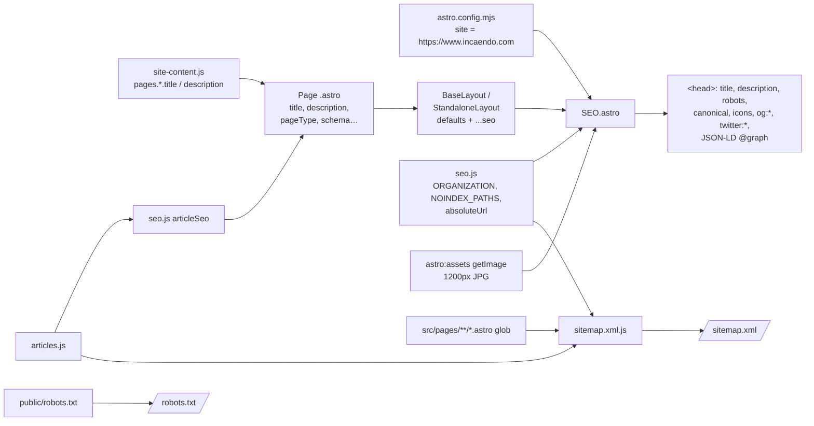

# SEO Implementation

Technical documentation of the search engine optimisation (SEO) work on the
Incaendo corporate website: how metadata, canonical URLs, indexing rules,
structured data, the sitemap and `robots.txt` are produced, and what remains
for production.

| | |
| --- | --- |
| **Repository** | `incaendo-corp` (Astro 7, static output) |
| **Production origin** | `https://www.incaendo.com`, set as `site` in `astro.config.mjs` |
| **Approach** | One shared `SEO.astro` component renders every page's `<head>` metadata and JSON-LD. Pages pass only their own values. |
| **Rendered pages** | 60 HTML pages, plus `/sitemap.xml` and `/robots.txt` |
| **Git status** | All SEO work is **uncommitted** on `feature/website-enhancement`. `SEO.astro`, `src/data/seo.js` and `src/pages/sitemap.xml.js` are untracked; the layouts, pages, `site-content.js`, `robots.txt`, `README.md` and `.env.example` are modified. |
| **Evidence** | Values in this document were taken from the source and from a fresh production build (`astro build` into a scratch folder on 2026-11-10, Node 22.22.0), whose HTML was parsed with a script. |

> **Status labels used below.**
> **Implemented and verified**: present in code and confirmed in the built HTML.
> **Implemented, not verified**: present in code, but its real-world effect
> was not tested. **Not implemented.** **Requires production configuration**:
> needs the host, CDN or an external dashboard. **Recommendation**: a possible
> future improvement, not done.

---

## 1. Executive Summary

**What was done.** Every page of the website now tells search engines and
social networks, in a consistent way:

- its **title** and **summary** (what appears in Google results),
- its **one official address** (canonical URL), so duplicate addresses don't
  compete with each other,
- whether it **should appear in search** at all (draft and placeholder pages are
  kept out),
- what it **looks like when shared** on LinkedIn, Facebook, X and WhatsApp
  (title, summary, image),
- **structured facts** in Google's standard format (schema.org): the company,
  its address and social profiles, the six services, the NIRVAN product,
  published articles and breadcrumb trails.

The site now also publishes a **sitemap**, an automatically maintained list of
every page that should be indexed, and `robots.txt` points crawlers to it.

**Business objective.** Help search engines discover, understand and correctly
present Incaendo's pages, and consolidate ranking signals onto one URL per
page. This makes the site *eligible* to perform well. It does **not**
guarantee rankings (§10).

**Approach.** Previously each layout hand-wrote a few tags. Canonical URLs and
social images appeared **only if** a `PUBLIC_SITE_URL` environment variable
was set, and it never was. Now one component (`SEO.astro`) generates all
metadata from a single production origin. Shared rules live in one data file
(`src/data/seo.js`). Pages supply only their title, description and, where
relevant, a page type or extra schema.

**Completed:** metadata, canonical URLs, robots directives, Open Graph/X cards,
JSON-LD, sitemap, `robots.txt` sitemap reference, revised titles and
descriptions for several pages.

**Remaining:** hosting-level redirects (http→https, apex→www, trailing slash,
legacy routes), a real 404 status, Google Search Console setup, and checks
that can only be run on the live site (§9, §13).

---

## 2. SEO Architecture

### How metadata is managed

| Layer | File | Role |
| --- | --- | --- |
| Production origin | `astro.config.mjs` (`site: 'https://www.incaendo.com'`) | Base for every absolute URL. Exposed to components as `Astro.site`. |
| Shared SEO data | `src/data/seo.js` | Organisation facts, the `NON_CANONICAL_PATHS` and `NOINDEX_PATHS` lists, the `absoluteUrl()` helper, `isDraftArticle()`, `articleSeo()` |
| Page copy | `src/data/site-content.js` → `pages` | Title and description for most static pages |
| Article data | `src/data/articles.js` | Title, excerpt, image, author, date, category and tags for insight articles |
| Layout defaults | `BaseLayout.astro`, `StandaloneLayout.astro` | Default title and description. Pass all other SEO props through (`...seo`). `StandaloneLayout` sets `siteName="NIRVAN by Incaendo"`. |
| Renderer | `src/components/SEO.astro` | Builds every tag and the JSON-LD graph |
| Sitemap | `src/pages/sitemap.xml.js` | Generates `/sitemap.xml` at build time |
| Crawler rules | `public/robots.txt` | Copied to the site root as-is |

### Defaults vs page-specific values

| Prop (passed to the layout) | Default | Used by |
| --- | --- | --- |
| `title`, `description` | BaseLayout: `Incaendo \| Software Development & Technology` / "Incaendo is a software development and technology company with 15 years of industry experience." | Every page overrides both. |
| `canonicalPath` | Current URL path | `/insights/`, `/privacy-policy/`, articles (`articleSeo`) |
| `noindex` | `false` (plus anything in `NOINDEX_PATHS`) | Draft articles |
| `openGraphType` | `website` | Articles → `article` |
| `image`, `imageAlt` | `src/assets/hero-orbit.png`, "Incaendo software engineering and technology" | NIRVAN, articles |
| `pageType` | `WebPage` | Contact → `ContactPage`; Teams → `AboutPage`; Insights, Projects → `CollectionPage` |
| `breadcrumbs`, `breadcrumbLabel` | none | Articles (Home › Insights › article) |
| `article` | none | Published articles (date, section, tags) |
| `schema` | `[]` | Services (`Service` ×6), NIRVAN (`SoftwareApplication`), published articles |
| `siteName` | `Incaendo` | NIRVAN (`NIRVAN by Incaendo`) |

### How the head is generated



Everything runs at **build time**. The output is static HTML, so search
engines receive complete metadata without running JavaScript.

`SEO.astro` steps:

1. `canonicalUrl = absoluteUrl(canonicalPath, Astro.site)` normalises to
   trailing-slash form (`/about` → `https://www.incaendo.com/about/`). Paths
   with a file extension are left unchanged.
2. Robots: `noindex, follow` if `noindex` is true or the canonical path is in
   `NOINDEX_PATHS`. Otherwise `index, follow, max-image-preview:large`.
3. Social image: an imported image is re-encoded through Astro's image
   pipeline to a **1200 px wide JPG**, with width and height recorded. A string
   path is made absolute.
4. A single JSON-LD `@graph` is built: `Organization`, `WebSite`, the page
   node and an optional `BreadcrumbList`, plus page `schema` nodes. Page nodes
   can reference shared entities with `{ $ref: 'organization' | 'webPage' |
   'image' }`, and these are resolved to `@id` links. `<` is escaped as
   `<` so content can't close the script tag.

---

## 3. Page-by-Page SEO Implementation

### 3.1 Summary table (values from the built HTML)

All URLs below are relative to `https://www.incaendo.com`. "Std OG" means
Open Graph and Twitter tags with the default `hero-orbit` image (1200×675
JPG).

| Route | Page title | Meta description | Canonical | Robots | Open Graph | JSON-LD types | Status |
| --- | --- | --- | --- | --- | --- | --- | --- |
| `/` | Incaendo \| Custom Software, AI & App Development Company | Incaendo is a Noida-based software development company with 15 years of experience building custom software, web and mobile apps, AI solutions and cloud platforms. | `/` | index | Std OG | Organization, WebSite, WebPage (`about` → Organization) | Verified |
| `/ai-technology/` | AI & Applied Solutions \| Incaendo | Explore practical AI applications, integration patterns, and enterprise considerations. Incaendo connects business data, existing systems, and workflows to useful outcomes. | self | index | Std OG | Organization, WebSite, WebPage | Verified |
| `/services/` | Software, AI & Technology Services \| Incaendo | Explore Incaendo’s AI, software, web, mobile, enterprise, and cloud technology services, and how they can address practical business needs. | self | index | Std OG | + 6 × Service | Verified |
| `/projects/` | Projects & Digital Portfolio \| Incaendo Technologies | Explore a selection of Incaendo project work across digital products, media, commerce, financial platforms, operations, and learning. | self | index | Std OG | CollectionPage | Verified |
| `/teams/` | Our Team & Expertise \| Incaendo | Meet the people behind Incaendo across leadership, software engineering, architecture, quality assurance, finance and HR. | self | index | Std OG | AboutPage | Verified |
| `/insights/` | Technology Insights & Engineering Ideas \| Incaendo | Articles and case studies from Incaendo on choosing a software partner, custom software, tech stacks, AI, web development, cloud and data. | `/insights/` (explicit) | index | Std OG | CollectionPage | Verified |
| `/contact/` | Discuss a Project \| Contact Incaendo | Tell us about your software, web, mobile or AI project. Send an enquiry to the Incaendo team in Noida or email info@incaendo.com. | self | index | Std OG | ContactPage | Verified |
| `/faq/` | Frequently Asked Questions \| Incaendo | Frequently asked questions about Incaendo mobile app development, web applications, UI/UX design, and technology solutions. | self | index | Std OG | WebPage | Verified |
| `/careers/` | Careers & Opportunities \| Incaendo | Careers at Incaendo, a software development company in Noida. No openings are listed right now; roles will be published here when ready. | self | **noindex, follow** | Std OG | WebPage | Verified (excluded from sitemap) |
| `/privacy-policy/` | Privacy Policy \| Incaendo | Read Incaendo's Privacy Policy to understand how we collect, use, protect, and manage your personal information while you use our website and services. | `/privacy-policy/` (explicit) | index | Std OG | WebPage | Verified |
| `/terms-and-conditions/` | Terms & Conditions \| Incaendo | Read Incaendo's Terms & Conditions governing access to and use of our website, products, and technology services. | self | index | Std OG | WebPage | Verified |
| `/products/nirvan/` | NIRVAN \| Healthcare CRM & Hospital Management Platform | Simplify healthcare operations with one connected platform for clinics, hospitals, and growing healthcare networks. Patient management, appointment scheduling, billing, and clinical workflows. | self | index | og:site_name "NIRVAN by Incaendo", dashboard image, custom alt | + SoftwareApplication | Verified |
| `/blog/` (legacy) | Same as `/insights/` | Same as `/insights/` | **`/insights/`** | index | Std OG | CollectionPage | Verified (duplicate, excluded from sitemap) |
| `/privacy/` (legacy) | Same as `/privacy-policy/` | Same | **`/privacy-policy/`** | index | Std OG | WebPage | Verified (duplicate, excluded from sitemap) |
| `/insights/<slug>/` ×14 | `<article title> \| Incaendo` | Article excerpt | self | index (4 published) / **noindex** (10 drafts) | `og:type=article`, article image | WebPage, BreadcrumbList (+ BlogPosting or Article if published) | Verified |
| `/blog/<slug>/` ×16, `/post/<slug>/` ×16 (legacy) | Same as the article | Same | **`/insights/<slug>/`** | Same as the article | Same | Same | Verified (excluded from sitemap) |

### 3.2 Insight articles

An article counts as a **draft** when it has no author and is neither a
published blog nor a case study (`isDraftArticle`). Drafts are marked
`noindex, follow`, get no `article:*` tags and no article schema, and are left
out of the sitemap, because their pages carry a "replace before publication"
notice.

| `/insights/` slug | Robots | Schema | Sitemap `lastmod` |
| --- | --- | --- | --- |
| `how-to-choose-the-right-software-development-company-in-noida-for-your-business` | index | BlogPosting | 2026-08-24 |
| `how-custom-software-development-empowers-your-business-to-automate-scale-and-grow-in-2026` | index | BlogPosting | 2026-08-17 |
| `choosing-the-right-tech-stack-for-your-startup-in-2025` | index | BlogPosting | 2025-04-21 |
| `case-study-how-we-helped-dominos-india-centralise-data-automate-settlements-and-refunds` | index | Article | 2025-04-11 |
| `accessible-responsive-interfaces-that-scale` | noindex | — | — |
| `cicd-practices-reliable-delivery` | noindex | — | — |
| `data-quality-foundation-business-analytics` | noindex | — | — |
| `designing-maintainable-apis-growing-products` | noindex | — | — |
| `from-ai-experiments-to-production` | noindex | — | — |
| `improving-web-application-performance` | noindex | — | — |
| `making-cloud-infrastructure-observable` | noindex | — | — |
| `moving-machine-learning-models-into-production` | noindex | — | — |
| `practical-ai-integration-existing-applications` | noindex | — | — |
| `technology-decisions-digital-change` | noindex | — | — |

The `/blog/` and `/post/` routes also serve two **alias slugs**, kept from older
URLs. Both canonicalise to the current article:
`choosing-tech-stack-for-startup-2025` and
`case-study-how-we-helped-domino-s-india-centralise-data-automate-settlements-and-refunds`.

### 3.3 What changed per page, and why

| Page | Change (from `git diff`) | Why | Metadata source |
| --- | --- | --- | --- |
| All pages | Head tags moved from the layouts into `SEO.astro`. Canonical, `og:url` and image are now always present. Robots, icons, `og:locale`, image dimensions and alt, and JSON-LD added. | Before, the canonical and social image depended on an unset env var, so production HTML would have had **no canonical and no share image**. | Inherited from the layout and `SEO.astro` |
| `/` | Title changed from "Software Engineering for What Comes Next" to "Custom Software, AI & App Development Company". The description now names Noida and the service lines. | Title and description now state what the company offers and where. | `pages.home` (overridden) |
| `/faq/` | Title "FAQ \| Incaendo" changed to "Frequently Asked Questions \| Incaendo". | Uses the full phrase instead of an abbreviation. | `pages.faq` |
| `/insights/` | Description rewritten (it no longer says "sample editorial drafts"). Explicit canonical `/insights/`. `CollectionPage`. | Describes the real published content. The explicit canonical also makes `/blog/` consolidate onto `/insights/`, because `/blog/` renders this same page. | `pages.insights` + page props |
| `/contact/` | Description rewritten (it no longer says the form is awaiting an endpoint). `ContactPage`. | The form now submits to HubSpot. | `pages.contact` + `pageType` |
| `/careers/` | Description rewritten. `noindex` through `NOINDEX_PATHS`. | The page has no openings and shows a placeholder notice. | `pages.careers`; robots generated |
| `/teams/` | `AboutPage`. | Describes the organisation's people. | `pageType` |
| `/projects/` | `CollectionPage`. | It's a list of project entries. | `pageType` |
| `/services/` | Six `Service` nodes (`name`, `description`, `url` → `/services/#<id>` anchor, `provider` → Organization). All six anchors exist in the HTML. | Describes the services as entities of the organisation. | `homepageServices` in `site-content.js` |
| `/privacy-policy/` | Explicit canonical `/privacy-policy/`. | `/privacy/` renders this same page, so it consolidates here. | Page prop |
| `/products/nirvan/` | `SoftwareApplication` schema. Description moved into a shared `pageDescription` constant. Custom share image and alt. | Product page with its own brand. | Page props through StandaloneLayout |
| Article routes (all three folders) | Title suffix changed from "\| Incaendo Insights" to "\| Incaendo". Now uses `articleSeo()`: canonical to `/insights/<slug>/`, draft noindex, `og:type=article`, breadcrumbs, BlogPosting or Article. | Removes the duplicate-content problem of the same article on 3–4 URLs. Keeps drafts out of search. | Generated by `articleSeo()` |
| `/ai-technology/`, `/terms-and-conditions/` | No page-level change beyond the shared head. | — | Literal props / `pages.terms` |

---

## 4. Meta Tags and Their Purpose

Defined in `src/components/SEO.astro` unless noted otherwise.

| Tag | What it does | Ranking signal or presentation? | Where | Scope |
| --- | --- | --- | --- | --- |
| `<meta charset="UTF-8">` | Character encoding | Technical prerequisite | Layouts | Global |
| `<meta name="viewport">` | Mobile layout | Prerequisite for mobile-friendliness | Layouts | Global |
| `<meta name="theme-color">` | Browser UI colour | Neither | Layouts | Global |
| `<html lang="en">` | Page language | Helps language understanding | Layouts | Global |
| `<title>` | Name of the page in results and browser tabs | Used for relevance **and** usually shown as the result headline (Google may rewrite it) | Line 140 | Page-specific |
| `meta description` | Page summary | **Presentation**: often used as the result snippet. Not a direct ranking factor. | Line 141 | Page-specific |
| `meta robots` | Allows or blocks indexing. `max-image-preview:large` permits large image previews. | Controls **whether** a page can appear, not how high | Lines 42–45, 142 | Generated per page |
| `link rel=canonical` | Declares the preferred URL | Consolidation **hint** (search engines may still choose differently) | Line 143 | Generated per page |
| `link rel=icon` / `apple-touch-icon` | Favicon (96×96) and iOS icon (180×180) | Presentation (Google shows favicons in mobile results) | Lines 144–145 | Global |
| `og:type, og:site_name, og:locale (en_US), og:title, og:description, og:url, og:image (+width, height, alt)` | Share preview on LinkedIn, Facebook, WhatsApp and similar | **Social presentation only** | Lines 147–160 | Page-specific values |
| `article:published_time, article:section, article:tag` | Article details for social platforms | Social presentation | Lines 161–169 | Published articles only |
| `twitter:card (summary_large_image), twitter:title, description, image, image:alt` | X/Twitter share card | Social presentation | Lines 171–175 | Page-specific values |
| JSON-LD `<script type="application/ld+json">` | Machine-readable facts | Helps understanding and **may** make a page eligible for rich results. Not a ranking guarantee. | Line 177 | Page-specific graph |

**Not implemented:** `twitter:site` / `twitter:creator`, `hreflang`, a
`meta keywords` tag (ignored by Google), a web app manifest, and
search-engine verification tags.

---

## 5. Technical SEO

| Item | Implementation | Status |
| --- | --- | --- |
| `robots.txt` | `User-agent: *`, `Allow: /`, `Sitemap: https://www.incaendo.com/sitemap.xml` (`public/robots.txt`) | Implemented and verified (in the build output) |
| XML sitemap | `/sitemap.xml`, 15 URLs (§7) | Implemented and verified |
| Canonical URLs | Absolute, production origin, trailing slash, on all 60 pages. Duplicates point to the primary URL. | Implemented and verified |
| Indexability | `index` by default. `noindex, follow` on `/careers/` and the 10 draft articles (and their legacy copies). | Implemented and verified |
| Crawlability | Static HTML. Metadata needs no JavaScript. Nothing is blocked in `robots.txt`. | Implemented and verified |
| URL structure | Short, lowercase, hyphenated slugs. Articles live under `/insights/`. The build emits `<route>/index.html`. | Implemented and verified |
| Trailing slash consistency | Canonicals and the sitemap use `/route/`, but **internal links use `/route` without a slash** (e.g. `/contact` 315 times, `/services` 125 times). | **Requires production configuration**: the host must 301 `/route` → `/route/` (`docs/deployment-checklist.md` §1) |
| Internal linking | Header, footer and cross-page links. A scan of the built HTML found **no broken internal links**. | Verified for the build output only |
| Links to legacy routes | 61 internal links to `/privacy` (a duplicate route) | Implemented but not ideal. Should become `/privacy-policy/` or be covered by a redirect. |
| Redirects | **None in the repository.** Duplicates are handled with canonicals until hosting exists. | **Requires production configuration** (`deployment-checklist.md` §2) |
| HTTP→HTTPS, apex→www | Not in the repository | **Requires production configuration** |
| 404 handling | No `src/pages/404.astro`. Real 404 status depends on the host. | Not implemented / requires host config |
| Duplicate content | `/blog/`, `/privacy/`, `/blog/*`, `/post/*` and the alias slugs are canonicalised and kept out of the sitemap | Implemented and verified |
| Mobile responsiveness | Viewport tag, Bootstrap grid and responsive CSS | Implemented, not verified with Google's tools |
| Performance | `astro:assets` serves WebP with width and height (prevents layout shift), `loading`/`fetchpriority` hints, static output. Google Fonts preconnected with `display=swap`. | Implemented, **not measured** (no Lighthouse or Core Web Vitals data) |
| Entrance animations | `EntranceMotionBoot.astro` briefly pre-hides content for animation, with a 3 s failsafe. Content is in the HTML. | Implemented. Effect on rendering-based crawlers not verified. |
| Image alt text | All 606 `` tags in the build have an `alt` attribute. About 155 have an empty `alt` (meant as decorative), including the home page client logos. | Implemented. Whether the client logos should have names as alt text needs a content review. |
| Heading hierarchy | Exactly **one `<h1>` on each of the 60 pages** (verified). Deeper levels were not audited. | Partially verified |
| Semantic HTML | `<main id="main-content">`, `<header>`, `<section aria-labelledby>`, `<figure>` used across pages | Implemented, not audited |
| Structured data | §6 | Implemented. Not validated with Google's Rich Results Test. |
| Non-production indexing | Preview builds emit production canonicals. No `noindex` for staging. | **Requires production configuration** (`deployment-checklist.md` §3) |

---

## 6. Structured Data / Schema Markup

**Format:** one JSON-LD `@graph` per page, generated in `SEO.astro` lines
59–137. Entities link to each other by `@id`, so search engines see one
connected description instead of separate fragments.

| Type | `@id` | Key properties | Pages | Source |
| --- | --- | --- | --- | --- |
| `Organization` | `https://www.incaendo.com/#organization` | name "Incaendo Technologies", alternateName "Incaendo", url, logo (ImageObject 633×145), email, PostalAddress (Noida, UP, 201301, IN), sameAs (Facebook, Instagram, LinkedIn) | All | `ORGANIZATION` in `seo.js` |
| `WebSite` | `…/#website` | url, name "Incaendo", publisher → Organization, inLanguage `en` | All | `SEO.astro` |
| `WebPage` / `ContactPage` / `AboutPage` / `CollectionPage` | `<canonical>#webpage` | url, name, description, isPartOf → WebSite, primaryImageOfPage, breadcrumb, `about` → Organization (home only), inLanguage | All | `pageType` prop |
| `BreadcrumbList` | `<canonical>#breadcrumb` | Home → Insights → article (last item has no URL) | Articles | `articleSeo()` |
| `BlogPosting` / `Article` | (none) | headline, description, image → primary image, datePublished, author (Person), publisher → Organization, mainEntityOfPage, articleSection, keywords, inLanguage | 4 published articles (`Article` for the case study) | `articleSeo()` |
| `Service` ×6 | `…/services/#<id>` | name, description, url, provider → Organization | `/services/` | `services.astro` |
| `SoftwareApplication` | `…/products/nirvan/#software` | name "NIRVAN", applicationCategory `BusinessApplication`, description, url, featureList (8 items), publisher, mainEntityOfPage | `/products/nirvan/` | `nirvan.astro` |

The comment in `seo.js` says organisation data is limited to **facts visible
on the website** (footer and contact page). No ratings, prices, telephone
numbers or founding dates are stated.

**Why it's useful.** It describes the business entity (name, logo, address,
profiles) in a standard vocabulary. Breadcrumbs and article markup are the
types Google may use for enhanced result displays. `Service` and
`SoftwareApplication` describe offerings. Google's software-app rich result
also needs properties such as offers and ratings, which are **not**
included, so the NIRVAN markup is descriptive only.

**Sanitised example** (home page, from the build; logo filename shortened):

```json
{
  "@context": "https://schema.org",
  "@graph": [
    {
      "@type": "Organization",
      "@id": "https://www.incaendo.com/#organization",
      "name": "Incaendo Technologies",
      "alternateName": "Incaendo",
      "url": "https://www.incaendo.com/",
      "logo": { "@type": "ImageObject", "url": "https://www.incaendo.com/_astro/incaendo-logo.<hash>.png", "width": 633, "height": 145 },
      "email": "info@incaendo.com",
      "address": { "@type": "PostalAddress", "addressLocality": "Noida", "addressRegion": "Uttar Pradesh", "postalCode": "201301", "addressCountry": "IN", "streetAddress": "…" },
      "sameAs": ["https://www.facebook.com/Incaendo/", "https://www.instagram.com/incaendo_technologies/", "https://www.linkedin.com/company/incaendo-technologies-pvt-ltd-/"]
    },
    { "@type": "WebSite", "@id": "https://www.incaendo.com/#website", "url": "https://www.incaendo.com/", "name": "Incaendo", "publisher": { "@id": "https://www.incaendo.com/#organization" }, "inLanguage": "en" },
    {
      "@type": "WebPage",
      "@id": "https://www.incaendo.com/#webpage",
      "url": "https://www.incaendo.com/",
      "name": "Incaendo | Custom Software, AI & App Development Company",
      "isPartOf": { "@id": "https://www.incaendo.com/#website" },
      "about": { "@id": "https://www.incaendo.com/#organization" },
      "primaryImageOfPage": { "@type": "ImageObject", "@id": "https://www.incaendo.com/#primaryimage", "url": "https://www.incaendo.com/_astro/hero-orbit.<hash>.jpg", "width": 1200, "height": 675 },
      "inLanguage": "en"
    }
  ]
}
```

**Validation status:** the JSON parses for all 60 pages (verified by the
extraction script). It has **not** been run through Google's Rich Results
Test or the Schema.org validator.

---

## 7. Sitemap and Robots Workflow

### Sitemap (`src/pages/sitemap.xml.js`)

At build time it does the following:

1. Finds every `.astro` file under `src/pages` with `import.meta.glob`, skips
   dynamic routes (`[slug]`) and converts each file path to a URL path. **New
   static pages are added automatically.**
2. Adds `/insights/<slug>/` for each article that isn't a draft, with
   `<lastmod>` = `publishedAt`.
3. Removes `NON_CANONICAL_PATHS` (`/blog/`, `/privacy/`) and `NOINDEX_PATHS`
   (`/careers/`).
4. Builds every URL with `absoluteUrl()` on `site`, so it always uses
   `https://www.incaendo.com` with trailing slashes. Entries are sorted and
   XML-escaped and served as `application/xml`.

**Current output: 15 URLs.** These are `/`, `/ai-technology/`, `/contact/`,
`/faq/`, `/insights/`, the 4 published articles, `/privacy-policy/`,
`/products/nirvan/`, `/projects/`, `/services/`, `/teams/` and
`/terms-and-conditions/`. Only articles have `<lastmod>`. No `changefreq` or
`priority` values are set (Google ignores them).

### robots.txt (`public/robots.txt`)

```text
User-agent: *
Allow: /

Sitemap: https://www.incaendo.com/sitemap.xml
```

It allows all crawling and references the sitemap. (The `Sitemap:` line was
added in this work.) Pages that shouldn't be indexed are handled with
`noindex` instead of `Disallow`, because a crawler must be able to fetch a page
to see its `noindex`.

### Verifying

```bash
nvm use                       # Node 22 (.nvmrc = 22.22.0)
npm run build                 # writes dist/
cat dist/sitemap.xml
cat dist/robots.txt
npm run preview               # then open http://localhost:4321/sitemap.xml
```

In production:

```bash
curl -s https://www.incaendo.com/robots.txt
curl -s https://www.incaendo.com/sitemap.xml
curl -sI https://www.incaendo.com/sitemap.xml   # expect 200, application/xml
```

---

## 8. SEO Testing and Verification

### Existing automated tests

**None.** There is no test runner or SEO test. `package.json` scripts are
`dev`, `build`, `preview`, `lint` (ESLint) and `format` / `format:check`
(Prettier). The checks in this document were run once with a temporary
script outside the repository. They are not part of CI.

### Manual checks (commands work on a local `dist/` build)

| Check | How |
| --- | --- |
| Rendered head of one page | `npm run build && sed -n '/<head>/,/<\/head>/p' dist/teams/index.html`, or browser **View Source** |
| Canonical on every page | `grep -rho '<link rel="canonical"[^>]*>' dist --include=index.html \| sort \| uniq -c` |
| No local or preview domain leaked | `grep -rlE 'localhost\|trycloudflare\|127\.0\.0\.1' dist --include=*.html` (expect no output) |
| Robots directives | `grep -rl 'noindex' dist --include=index.html` (expect careers, draft articles and their legacy copies) |
| Missing titles or descriptions | `for f in $(find dist -name index.html); do grep -q '<meta name="description"' $f \|\| echo "$f"; done` |
| Duplicate titles | `grep -rho '<title>[^<]*' dist --include=index.html \| sort \| uniq -d` (duplicates are expected **only** for legacy routes that canonicalise elsewhere) |
| Open Graph tags | `grep -o '<meta property="og:[^>]*>' dist/index.html`. After launch, use LinkedIn Post Inspector and the Facebook Sharing Debugger. |
| JSON-LD | Copy the `application/ld+json` block into the Schema.org validator. After launch, use Google's Rich Results Test on a page and an article. |
| Sitemap and robots | §7 |
| Broken links | No link-checker is installed. The internal-link scan used for this document found none. **Recommendation:** run a crawler (e.g. Screaming Frog) on the live site. |
| Mobile and performance | Chrome DevTools device mode and Lighthouse; PageSpeed Insights after launch. **Not yet run.** |

### Findings to note

- Some indexable titles are long and will likely be **truncated in results**:
  the Domino's case study and the custom-software article titles (102
  characters each) and the Noida guide (90). Most static page titles are
  25–56 characters.
- Descriptions are 113–201 characters. The longer ones may be shortened in
  results. This is a presentation matter, not an error.
- `pages.ai` in `site-content.js` ("AI Technology & Innovation | Incaendo")
  is **unused**. `/ai-technology/` sets its title directly in the page.

---

## 9. Production Deployment: Minimal Required Changes

The SEO implementation is **production-ready in code**. The origin is fixed as
`site`, so canonicals, `og:url`, `og:image`, JSON-LD and the sitemap already
use `https://www.incaendo.com` in every build, including local and preview
builds. The remaining work is hosting configuration and external tools.

### 9.1 Required changes (hosting/CDN, not code)

Taken from `docs/deployment-checklist.md`:

- [ ] 301 redirect `http://` → `https://`.
- [ ] 301 redirect `incaendo.com` → `www.incaendo.com`.
- [ ] 301 redirect `/route` → `/route/`. Internal links use the slash-less
      form, and without this redirect every internal link points to a
      non-canonical URL.
- [ ] Unknown URLs return a real `404` status.
- [ ] Staging and preview deployments send `X-Robots-Tag: noindex` or are
      password-protected (their HTML contains production canonicals).

### 9.2 Configuration-only changes

- [ ] Legacy redirects (`/blog/` → `/insights/`, `/blog/:slug/` and `/post/:slug/` →
      `/insights/:slug/`, the alias slugs, `/privacy/` → `/privacy-policy/`). After
      that, the duplicate route files and `NON_CANONICAL_PATHS` can be removed
      (a follow-up code cleanup).
- [ ] Remove the temporary Cloudflare tunnel host from `astro.config.mjs`
      (`vite.preview.allowedHosts`). This affects `astro preview` only, not
      SEO output.

### 9.3 Not required

- **Environment variables:** none. `PUBLIC_SITE_URL` was removed, and
  `.env.example` documents this.
- **Changing the canonical or sitemap domain:** already production.
- **`robots.txt`:** already production-ready.
- **Page metadata code:** no change needed to launch.

### 9.4 Needs confirmation

- [ ] Hosting platform (not decided, according to `deployment-checklist.md`).
- [ ] That `www.incaendo.com` (not the apex) is the intended primary host.
- [ ] Whether the legacy URLs ever existed on a live site with backlinks.
      This affects how important the redirects are.
- [ ] Content sign-off for the draft articles and careers page before removing
      `noindex`.

---

## 10. Search Engine Ranking: What This Implementation Does and Does Not Do

**What it does**

- **Titles and descriptions** tell Google what each page is about, and are
  usually what people see in the results. A clear title helps relevance. A
  good description can improve how often people click.
- **Canonical URLs** say "these four addresses are the same article; credit
  this one". Without them, the duplicates split signals between them.
- **The sitemap** lists every page we want found. **`robots.txt`** confirms
  nothing is blocked and points to the sitemap. Together they help Google
  *discover* pages faster. Discovery is not ranking.
- **`noindex`** keeps placeholder content (careers, draft articles) from
  appearing in search and representing the company poorly.
- **Structured data** describes the company, services, product and articles
  in Google's vocabulary. It can make pages *eligible* for enhanced displays
  such as breadcrumbs or article details. Google decides whether to show
  them.
- **Social tags** make shared links look professional. This affects clicks
  from social media, not Google ranking.

**What it does not do**

- It does not guarantee higher rankings. Rankings depend mainly on **content
  quality and relevance**, **links from other websites**, competition and
  user experience. Technical SEO removes obstacles but doesn't create demand.
- Nothing is indexed yet just because the tags exist. Google must crawl the
  live site first. That typically takes days to weeks after launch and
  sitemap submission, and changes to existing pages can take longer to show.
- **No performance data exists yet.** There is no Search Console or analytics
  baseline in the repository, so no ranking or traffic claims can be made.

---

## 11. Google Search Console and Analytics

| Integration | Present in codebase? |
| --- | --- |
| Google Search Console verification (`google-site-verification` meta tag or file) | **No** |
| Bing Webmaster verification | **No** |
| Google Analytics 4 (`gtag`) | **No** |
| Google Tag Manager | **No** |
| Analytics-related env vars | **No** |
| HubSpot tracking code (`js-na2.hs-scripts.com`) | **Yes**: page views and visitor tracking in HubSpot (see `docs/contact-us-hubspot-integration.md`). It is not a search-engine tool. |

**After launch**, these need access to the Google or Bing accounts, which the
repository can't provide:

1. Verify the domain in Search Console. A **Domain property** via DNS TXT
   record covers http/https and www/apex and needs no code change. A URL-prefix
   property via meta tag would need a code change.
2. Submit `https://www.incaendo.com/sitemap.xml`.
3. Use URL Inspection on the home page and one article. Request indexing.
4. Do the same in Bing Webmaster Tools (it can import from Search Console).
5. Decide whether GA4 is needed in addition to HubSpot analytics. That is
   **not decided in the codebase**.

---

## 12. Troubleshooting

| Issue | Possible cause | Verification | Resolution |
| --- | --- | --- | --- |
| Page shows the default title "Incaendo \| Software Development & Technology" | Page doesn't pass `title` to the layout | View source; check the page's `<BaseLayout>` props | Add `title` (preferably in `pages` in `site-content.js`) |
| Missing or default description | Same, for `description` | Same | Add `description` |
| Canonical points to the wrong URL | Wrong `canonicalPath` prop, or a page rendered under another route | `grep canonical` on that page's HTML | Fix the prop. For duplicates, point to the primary route. |
| Canonical lacks a trailing slash or has the wrong host | `site` changed in `astro.config.mjs`, or `absoluteUrl` was bypassed | Inspect the HTML | Keep `site` as `https://www.incaendo.com`. Always use `absoluteUrl`. |
| Local or preview domain in metadata | Not expected: `site` is fixed | The `grep localhost\|trycloudflare` check in §8 | If found, look for hard-coded URLs added outside `SEO.astro` |
| New page missing from the sitemap | Page is dynamic (`[param]`), or its path is in `NOINDEX_PATHS` / `NON_CANONICAL_PATHS` | `cat dist/sitemap.xml` | Static pages appear automatically. Dynamic routes must be added in `sitemap.xml.js`. |
| Article missing from the sitemap | It counts as a draft (no author, not flagged published or case study) | Check the article in `articles.js` | Add the author and `isPublishedBlog` / `isCaseStudy` once the content is approved |
| Page not indexed | `noindex`, not crawled yet, quality or duplicate decision by Google | Page source robots tag; Search Console URL Inspection | Remove `noindex` if intended; request indexing; improve the content |
| Page "blocked by robots.txt" | `robots.txt` edited with `Disallow` | `curl /robots.txt` | Use `noindex` instead of `Disallow` for pages that shouldn't be indexed |
| Search Console reports "Duplicate, Google chose different canonical" | Slash/no-slash or legacy URLs served with 200 and no redirect | URL Inspection | Configure the redirects in §9 |
| Duplicate titles in an audit tool | Legacy `/blog/`, `/post/` or `/privacy/` routes | Check the canonical on those URLs | Expected until the redirects exist |
| Invalid structured data | A new `schema` node is missing fields, or a `$ref` name is unknown (only `organization`, `website`, `webPage`, `breadcrumb`, `image` resolve) | Rich Results Test or Schema.org validator | Fix the node in the page or in `articleSeo()` |
| Wrong or old image in a LinkedIn/Facebook preview | Platform cache | Post Inspector / Sharing Debugger | Re-scrape in the tool |
| No share image at all | Page served on an origin other than `site` before launch | Check that the `og:image` URL loads | Images resolve only once the production domain is live |
| Redirect chain (e.g. http → apex → www → slash) | Redirect rules applied in several steps | `curl -IL http://incaendo.com/services` | Make each variant 301 straight to the final URL |

---

## 13. Production Readiness Checklist

### Code-level (repository, before deploy)

- [ ] SEO files committed (they are currently uncommitted).
- [ ] `npm run lint` and `npm run build` succeed.
- [ ] Every page has a unique title and description (except the legacy routes).
- [ ] Every page has a canonical on `https://www.incaendo.com` (§8 grep).
- [ ] No `localhost` or `trycloudflare` in the built HTML.
- [ ] `noindex` only on `/careers/` and draft articles, unless intentionally changed.
- [ ] `dist/sitemap.xml` lists the expected 15 URLs (or more, if content changed).
- [ ] `dist/robots.txt` contains the `Sitemap:` line.
- [ ] JSON-LD for home, services, NIRVAN and one article passes the
      Schema.org validator.
- [ ] Lighthouse (mobile) run on home, services and an article; results recorded.
- [ ] Decision made on the 61 `/privacy` internal links and the slash-less link
      style (redirect or update).

### Hosting and external (after deploy)

- [ ] `http://` and apex URLs 301 to `https://www.` in one hop.
- [ ] `/services` 301s to `/services/`.
- [ ] Legacy redirects (§9.2) work.
- [ ] Unknown URLs return a `404` status.
- [ ] Staging is `noindex` or password-protected.
- [ ] `https://www.incaendo.com/robots.txt` and `/sitemap.xml` return 200.
- [ ] Search Console verified and sitemap submitted. Bing verified.
- [ ] Rich Results Test on the home page and a published article.
- [ ] Share previews checked on LinkedIn and Facebook for a page and an article.
- [ ] PageSpeed Insights (mobile) on key pages.
- [ ] After about 1–2 weeks: Search Console **Pages** report shows the 15 sitemap
      URLs indexed or under review, with no unexpected exclusions.

---

## 14. Manager-Friendly Implementation Summary

**What was completed.** I set up the website so every page clearly tells
Google and social networks what it is, where its official address is, and
whether it should appear in search. I also added an automatic sitemap that
lists every page we want Google to find.

**How it works across the site.** A single shared component writes all of
this for every page automatically. Each page only provides its own title and
summary. The rest (official address, share preview, company details for
Google, search permissions) is generated the same way everywhere. That means:

- **consistency**: no page can be forgotten or written differently,
- **one place to change**: updating the company address or social links
  updates all 60 pages,
- **safety**: the production web address is fixed, so test builds can never
  publish wrong addresses.

**Page-specific work.** I rewrote the home page title and description to say
what we do and where (custom software, AI, apps, Noida). I updated outdated
descriptions on Insights, Contact and Careers. I added detailed company,
service, product (NIRVAN) and article information in Google's standard
format. I hid placeholder pages (careers, draft articles) from search until
their content is ready.

**Technical groundwork.** Old blog and post addresses now point Google to the
main Insights address, so duplicates don't compete. `robots.txt` lets search
engines in and points them to the sitemap.

**What's needed at launch.** No code changes. The hosting setup needs
redirects (http→https, incaendo.com→www, old blog URLs→new ones), and someone
with Google access needs to verify the site in Search Console and submit the
sitemap.

**What to monitor after launch.** In Search Console: pages indexed, search
impressions, clicks, average position for key terms (e.g. "software
development company Noida") and any coverage errors. In HubSpot: inquiries
coming from organic search. Results take weeks to months to appear, and
depend mostly on content and reputation. This work removes technical
barriers; it doesn't guarantee rankings.

---

## 15. Code References

| File | Responsibility | SEO relevance |
| --- | --- | --- |
| `astro.config.mjs` (line 7) | `site: 'https://www.incaendo.com'` | Base of every canonical, social, JSON-LD and sitemap URL |
| `src/components/SEO.astro` | Props and defaults (lines 17–38); canonical and robots (40–45); social image (47–57); JSON-LD graph (59–137); tags (140–177) | All head metadata |
| `src/data/seo.js` | `SITE_NAME` (4), `ORGANIZATION` (6–22), `NON_CANONICAL_PATHS` (26), `NOINDEX_PATHS` (30), `absoluteUrl()` (37–43), `isDraftArticle()` (50–51), `articleSeo()` (58–101) | Shared rules and article SEO |
| `src/pages/sitemap.xml.js` | Page discovery (12–21), exclusions (23), `GET` (28–56) | `/sitemap.xml` |
| `public/robots.txt` | Crawler rules and sitemap reference | `/robots.txt` |
| `src/layouts/BaseLayout.astro` | Defaults (11–17), charset and viewport (23–24), `<SEO>` (41) | Wraps every page except NIRVAN |
| `src/layouts/StandaloneLayout.astro` | Defaults (8–14), `<SEO siteName="NIRVAN by Incaendo">` (24–29) | NIRVAN page |
| `src/data/site-content.js` | `pages` object (from line 187) | Titles and descriptions for static pages |
| `src/data/articles.js` | 14 articles: slug, title, excerpt, author, date, flags | Article metadata, draft status, sitemap entries |
| `src/pages/services.astro` | `serviceSchema` (5–15) | 6 `Service` nodes |
| `src/pages/products/nirvan.astro` | `softwareSchema` (242–254), layout props (257–263) | `SoftwareApplication`, custom image |
| `src/pages/insights.astro` | `canonicalPath="/insights/"`, `CollectionPage` | Consolidates `/blog/` |
| `src/pages/privacy-policy.astro` | `canonicalPath="/privacy-policy/"` | Consolidates `/privacy/` |
| `src/pages/contact.astro`, `teams.astro`, `projects.astro` | `pageType` props | ContactPage, AboutPage, CollectionPage |
| `src/pages/insights/[slug].astro`, `blog/[slug].astro`, `post/[slug].astro` | `articleSeo(article)`; blog and post add 2 alias slugs | Article SEO and duplicates |
| `src/pages/blog/index.astro`, `src/pages/privacy.astro` | Re-render the primary page | Legacy duplicates (canonicalised) |
| `src/components/EntranceMotionBoot.astro` | Pre-hides entrance content (3 s failsafe) | Rendering consideration |
| `public/favicon-96x96.png`, `public/apple-touch-icon.png` | Icons | Favicon in results and on devices |
| `src/assets/hero-orbit.png` | Default share image (output as a 1200×675 JPG) | og:image and twitter:image |
| `.env.example` | States that no env var is needed for SEO | Configuration |
| `README.md` (SEO paragraph) | Summary of the SEO setup | Documentation |
| `docs/deployment-checklist.md` | Redirects, staging noindex, launch tasks | Production dependencies |

---

## 16. Known Limitations and Future Improvements

### Limitations (current state)

1. **No redirects yet.** Duplicates rely on canonical tags, which are hints,
   until the host is configured.
2. **Internal links have no trailing slash**, unlike the canonicals. They
   depend on a host redirect.
3. **61 internal links point to `/privacy`**, a duplicate route.
4. **No custom 404 page.** The real 404 status depends on the host.
5. **No automated SEO tests.** Regressions (a missing description, an
   accidental `noindex`) would not be caught in CI.
6. **Long titles** on three published articles will be truncated in results.
7. **All non-article pages share one generic share image.**
8. **Breadcrumb schema exists only on articles.** No visible-breadcrumb parity
   was checked.
9. **`SoftwareApplication` lacks offers and ratings**, so it isn't eligible for
   Google's software rich result.
10. **Unused `pages.ai` entry** in `site-content.js`.
11. **Ten draft articles and the careers page are `noindex`** until their
    content is approved.
12. **No measurement yet.** No Search Console, GA4, Lighthouse or Core Web
    Vitals data.

### Not yet verified

- Rich Results Test and Schema.org validation.
- Mobile-friendliness and performance scores.
- Social previews on the live domain.
- Indexing status (only possible after launch).
- Heading levels below `<h1>`, and the alt-text decisions for decorative
  images and client logos.

### Recommendations (not implemented)

- Add a build-time check (a small script in CI) for a title, description and
  canonical on every page, plus unique titles among indexable pages.
- Change internal links to the trailing-slash form and `/privacy-policy/`.
- Shorten the three long article titles, or give them a separate SEO title.
- Add page-specific share images for key pages (services, contact, teams).
- Add `src/pages/404.astro`.
- Consider breadcrumb schema for the top-level pages, and a `twitter:site`
  handle if an official X account exists.
- After the redirects exist, remove the `/blog/`, `/post/` and `/privacy` route
  files and `NON_CANONICAL_PATHS`.
